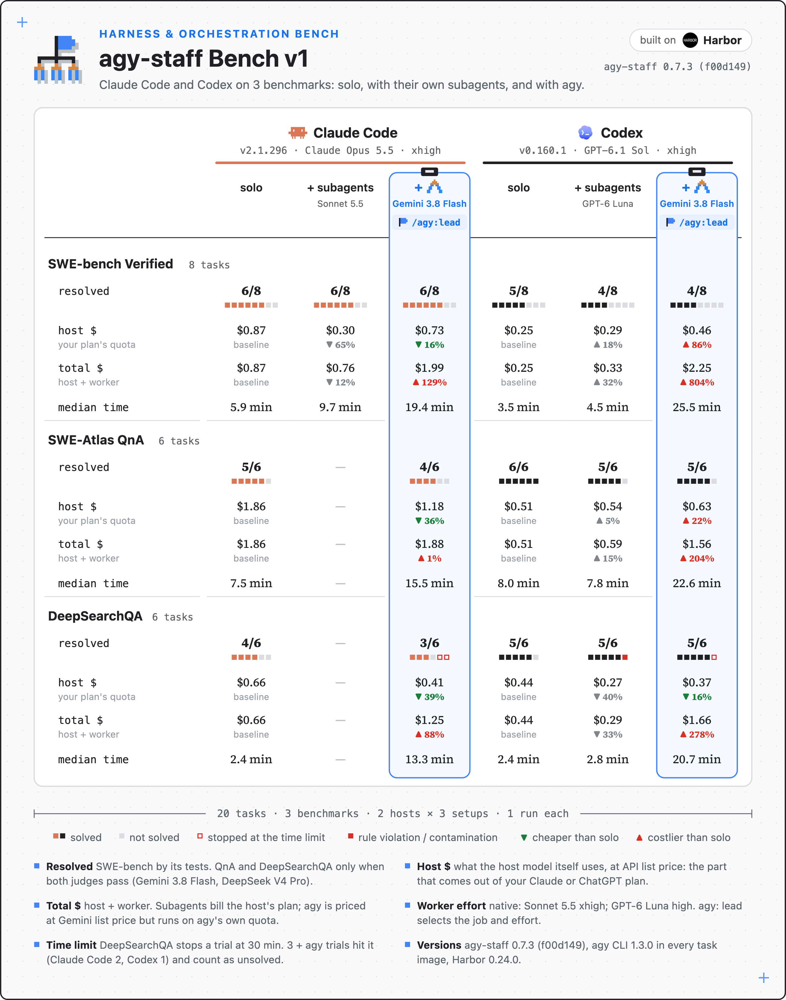
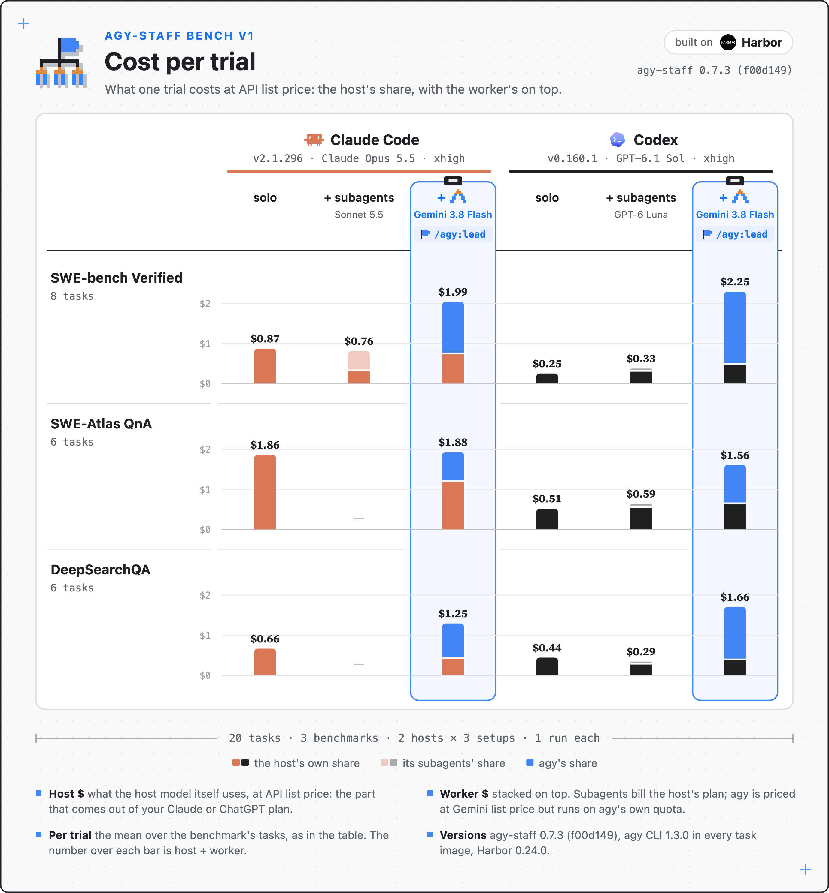
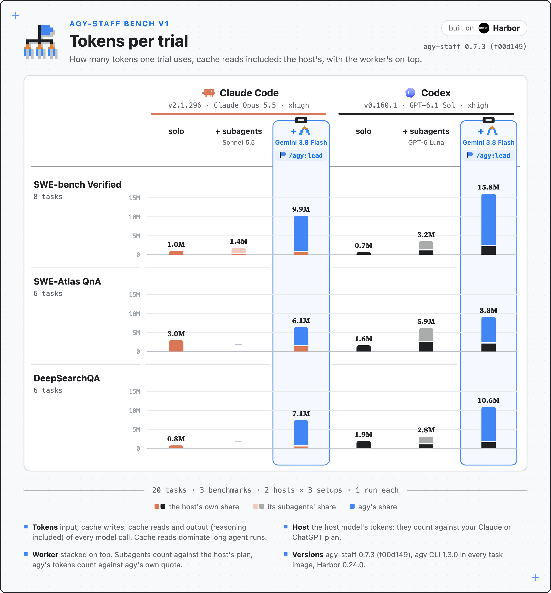
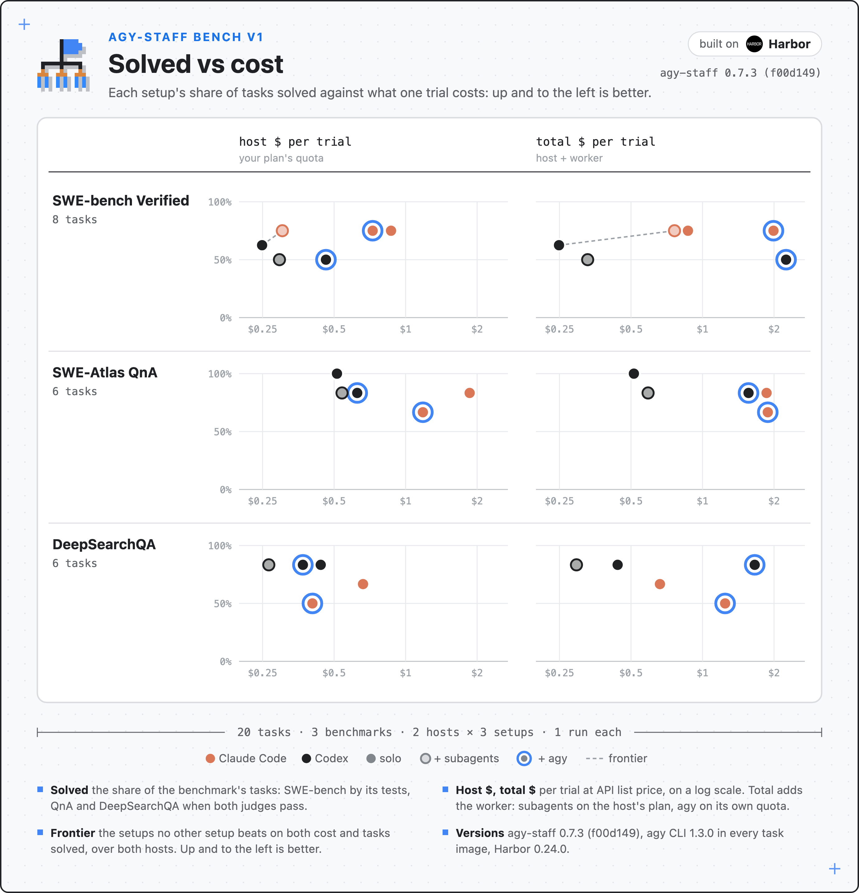

#  agy-staff Bench

[English](README.md) | [简体中文](README.zh-CN.md)

agy-staff Bench 衡量主 agent 把工作委派给 agy 要付出什么、能换来什么。每道题用三种编排方案各跑一次：主 agent 自己做；主 agent 用自家的 subagent；主 agent 通过 `lead` 用 agy。表里给出解出的题数、host 成本、总成本和耗时。

[](results/v1/summary.svg)

> [!NOTE]
> **为什么做这个评测。** 同一批题目，换不同的 host，分别用和不用 agy 来做，回答三个问题：
> - **什么时候该委派。** 哪些任务、哪个 host 交给 agy 更划算，哪些留给 host 自己做更好。结论会沉淀成 agy-staff 的最佳实践。
> - **agy-staff 该改什么。** 每次评测都会暴露委派在哪里浪费了时间或 token。这些发现会回到插件里变成修复，之后的评测版本再验证修复是否有效。
> - **不同 harness 的运行行为。** 从轨迹看各个 host 怎样委派、等待和验收。worker 模型和 effort 不同，不能只凭表格把跨 host 的差异归因于编排。

## v1 的结论

- **Claude Code 当 host：** 用 agy 之后，三个 benchmark 的 host 成本都下降了：SWE-bench Verified −16%，SWE-Atlas QnA −36%，DeepSearchQA −39%。host 成本就是从你的 Claude 订阅里扣的那部分。SWE-bench 上三种编排方案的结果完全相同，都是 6/8。代价是时间（耗时中位 13–19 分钟，单独做是 2–8 分钟），以及 agy 自己额度上的 worker 成本。
- **Codex 当 host：** 只有 DeepSearchQA 的 host 成本下降了（−16%）。SWE-bench（+86%）和 QnA（+22%）都更贵。Codex 等 agy 时会反复轮询，每次被唤醒都要带上完整的上下文；Claude Code 在后台等，任务完成后才被唤醒。
- **agy 输在哪：** Claude Code 这一侧，有 3 道题单独做解出了、用 agy 没解出。其中 2 道是 DeepSearchQA 跑到 30 分钟上限，还没写出答案；1 道是 QnA 的评委分歧：Gemini 3 次都判通过，DeepSeek 只判通过 1 次。另外有 1 道 DeepSearchQA，Claude Code 单独做没解出，用 agy 解出了；两份答案给出的州相同，差别只是一个评委对一句提到 Puerto Rico 的话判法不同。
- **每种编排方案每道题只跑 1 次，一共 20 道题。** 差 1 道题在噪声范围内。v1 只是第一版基线，不是定论。

## 图表

和上面那张表是同一份结果，换三种方式画。

**每次 trial 的成本。** 下面是 host 的部分，上面叠着 worker 的部分。

[](results/v1/cost.svg)

**每次 trial 的 token 用量**，包括读缓存的部分。用 agy 时，一次 trial 的 token 大多是 agy 用的，算在 agy 自己的额度上。

[](results/v1/tokens.svg)

**解题数与成本。** 解出的题目比例对比每次 trial 的 host 成本和总成本。越靠左上越好。

[](results/v1/pareto.svg)

## 测的是什么

三种方案共用任务规则，最后一行指定编排方式和 worker。表里比较的是整套配置；不同 host 的 worker 能力、token 单价和 reasoning effort 并没有控制一致。

| 编排方案 | host 怎么做 | worker |
|---|---|---|
| solo | 自己做 | 无 |
| + subagents | 委派给自家的 subagent | Claude Code：Sonnet 5.5 xhigh；Codex：GPT-6 Luna high |
| + agy | prompt 要求它用 `lead`（`/agy:lead`、`$agy:lead`），由 lead 决定派哪些 agy 任务 | Gemini 3.8 Flash，agy CLI 1.3.0 |

v1 最初只在 SWE-bench Verified 上跑了"+ subagents"。2026-10-23 的补充实验现已填入 v1 的 Codex native QnA 和 DeepSearchQA 两栏；Claude Code native 在这两组上仍未测量。

每个 benchmark 对应一种使用 worker 的场景：

| benchmark | 题数 | 场景 | 怎样算解出 |
|---|---|---|---|
| SWE-bench Verified | 8 | 小的单个修复，是委派可能不划算的边界 | 官方测试通过 |
| SWE-Atlas QnA | 6 | 查仓库、得出结论 | 两个 LLM 评委都判 rubric 通过 |
| DeepSearchQA | 6 | 联网调研、汇总多个来源 | 两个 LLM 评委都判答案通过 |

题目用固定的随机种子抽取，题号见 `data.json`。

| host | CLI | 模型 | effort |
|---|---|---|---|
| Claude Code | 2.1.296 | Claude Opus 5.5 | xhigh |
| Codex | 0.160.1 | GPT-6.1 Sol | xhigh |

## 方法

- **运行框架：** [Harbor](https://github.com/harbor-framework/harbor) 0.24.0，每个 job 的 `lock.json` 都记录了这个版本。每次 trial 都在一个全新的容器里跑。容器用 benchmark 自己的镜像构建，再装上 host CLI、agy 和 agy-staff。
- **agy-staff 版本：** 0.7.3（`f00d149`）。对 Claude Code 和 Codex 来说，0.7.4 没有改动任何 skill、companion 代码或 prompt 模板，所以这批结果也代表 0.7.4。
- **评分：** SWE-bench 按测试评分。只有同名测试一个都没失败，才算通过：SWE-bench 的 SymPy 日志解析器按裸测试名记结果，后面同名的测试会盖掉前面的失败。v1 里这条规则改变了 1 道题的结果，官方的判定保留在 `data.json` 的 `resolved_official` 里。QnA 和 DeepSearchQA 在离线评分，沿用各数据集自己的评分 prompt、rubric 和汇总规则。和官方做法唯一的不同是评委模型：用 Gemini 3.8 Flash 和 DeepSeek V4 Pro，各评 3 次。只有两个评委各自多数判通过，才算解出。
- **成本：** 按 API 标价计，单位是美元。
  - host 成本是 host 模型自己用掉的部分，也就是从你的 Claude 或 ChatGPT 订阅里扣的那部分。
  - 总成本再加上 worker。自家 subagent 和 host 用同一份订阅；agy 按 Gemini 标价折算，但用的是 agy 自己的额度。
  - 所有 host 和 worker 都只算 token 成本：工具按次收的费用不算，工具背后那次模型调用的 token 照算。
  - Claude Code 的成本取它自己报告的 `costUSD`（已经和标价核对过），再减去 WebSearch 按次收的费用；Codex 的成本按它的 token 数计算。
- **耗时：** 每次 trial 的墙钟时间取中位数。原始基线是两到三个 trial 同时跑，native 补充实验来自之后的批次；耗时对比也包含了批次条件差异。
- **时限：** 按各 benchmark 自己的规定。DeepSearchQA 到 30 分钟就停止 agent，评当时答案文件里的内容，所以没写出答案的 trial 算没解出。
- **重跑：** 基础设施故障一律重跑，不算作没解出。
  - 有 12 次 trial 里 Claude Code 卡死了，或者被卡死检测误停了。它在容器里跑的是 x86 版，经过转译运行，所以这些 trial 用同一版本的 arm64 原生版重跑。`data.json` 里每次 trial 用的是哪个版本记在 `claude_binary` 字段。
  - Claude Code"+ subagents"的第一版 prompt 让 host 去自己写 subagent 定义，而没有直接委派。prompt 改过之后，这 8 次 trial 全部重跑，表里用的是重跑的结果。
- **答案暴露和一次违规：** DeepSearchQA 的答案表在网上有镜像。trajectory 里碰到过答案表或它所在数据集页面的 trial，在 `data.json` 里标了 `answer_key_exposure`。包含 native 补充实验后，v1 有 3 次命中，都是 0118 这道题：
  - Codex solo（解出）：有一条搜索结果链到数据集页面，摘要里只有题面。答案来自原始报告。
  - Claude Code + agy（没解出）：host 写给 agy 的 brief 漏掉了“不要查这个 benchmark”的规则，agy 下载了答案表，还在报告里引用了它。host 发现后弃用了 agy 的结果，自己重新核对原始资料，30 分钟到了还没核完。`data.json` 里用 `rule_violation` 记下了这次违规。v1 的作弊扫描命中都经过人工复核，这是唯一确认的一次，其余都是误报。
  - Codex native（没解出）：普通搜索把这道题的完整答案行返回到了 Luna worker 的上下文。实际答案内容污染已确认，单独用 `answer_key_contamination` 记录；不能据此确认有意查找 benchmark 答案。
  - 三次都按原始评分计入。native DeepSearchQA 的 5/6 包含一次受污染但未通过的 trial，不能称为六题完全无污染的结果。
  - 汇总图用红色实心小方块表示确认违规或实际答案内容污染，用红色空心小方块表示超时。超时优先显示：超时的 trial 只画空心红框，重叠的审计标记保留在数据里。仅碰到数据集链接的记录不单独标记。

## Codex native 补充实验（2026-10-23）

已完成的 12 题补齐了 Codex native 的空栏，配置为 GPT-6.1 Sol xhigh、GPT-6 Luna high、Codex CLI 0.160.1，题号和 prompt 与 v1 相同。实验来自之后的批次，登录账号和 runner 实现有变化，并非整张矩阵的受控重跑。Sonnet 5.5 和 Luna 没有按单价或能力匹配，不同厂商的 effort 标签也不等价。

| 补充的 native 组 | 解出 | 每题 host 美元 | 每题总成本美元 | 耗时中位数（分钟） |
|---|---:|---:|---:|---:|
| SWE-Atlas QnA | 5/6 | 0.5401 | 0.5900 | 7.85 |
| DeepSearchQA | 5/6 | 0.2656 | 0.2946 | 2.75 |

新增 job 严格取自完成的 `manifest-s61x-native-supplement-20261023-r1-rerun4.json`：首个有效 QnA trial 来自 rerun1，其余 11 个来自 rerun4，已排除被替代的 s6x 批次和基础设施失败尝试。分析记录追加到本地被 git 忽略的 `results/trials.jsonl`；发布的 `data.json` 保留准确 job 名和 `source_phase`。`runs` 记录了经实际 worker 轨迹核实的 native worker 模型及 effort。原有 96 个入选 trial 及其测量结果均保留。

## 已知局限

- 每种编排方案每道题只跑 1 次，一共 20 道题。
- Claude Code 的"+ subagents"只在 SWE-bench Verified 上跑了；补充后 Codex native 覆盖三个 benchmark。
- native worker 的模型、单价和 effort 不同，跨 host 的结果比较整套配置，不能单独归因于 harness。
- 替换评委模型，偏离了 QnA 和 DeepSearchQA 的官方评分做法。
- 耗时来自不同批次，也包含并发条件差异。
- prompt 和 `lead` 都没有告诉 host DeepSearchQA 有 30 分钟的时限。三次超时里，agy 的第一个调研 job 都用了约 21 分钟或更久，其中两次到 30 分钟时仍有 agy job 在跑，没有一个 host 先写下临时答案。下一版会在所有编排方案的 prompt 里写明时限。

## 文件

```
results/
└── v1/
    ├── summary.svg   这张表
    ├── summary.png   同一张表，渲染后放进 README（headless Chrome 3 倍渲染；rsvg-convert 会丢掉内嵌的数字字体）
    ├── cost.svg      每次 trial 的成本，分 host 和 worker（另有 cost.png）
    ├── tokens.svg    每次 trial 的 token 用量，分 host 和 worker（另有 tokens.png）
    ├── pareto.svg    解题比例对比每次 trial 的 host 成本和总成本（另有 pareto.png）
    └── data.json     表和图背后的 108 次 trial，以及每个格子的汇总
```

`data.json` 里每次 trial 记录了 host、模型、编排方案、benchmark 和题目；是否解出（SWE-bench 另有 `resolved_official`）、reward、`timed_out`、`answer_key_exposure`、`rule_violation` 和 `answer_key_contamination`；host 和 worker 各自的成本和 token；以及耗时（秒）。新增 trial 还有 `source_phase`；`runs` 包含 native worker 模型和 reasoning effort。

## 版本

每发布一张表，就在 `results/` 下新建一个目录。已发布的版本只接受明确批准且在下方记录的勘误或带日期的补充。补充可以填上缺失的方案，不替换原有 trial；换模型、prompt 或题目集仍需新版本。

| 版本 | 发布日期 | agy-staff | host | 题数 | 改动 |
|---|---|---|---|---|---|
| [v1](results/v1/) | 2026-10-19 | 0.7.3（`f00d149`） | Claude Code 2.1.296（Opus 5.5 xhigh）；Codex 0.160.1（GPT-6.1 Sol xhigh） | 20 | 第一版基线 |

**v1 补充（2026-10-20）：** 新增三张图，都由同一份 `data.json` 画出：每次 trial 的成本、token 用量，以及解题数与成本。之前发布的文件都没有改动。

**v1 勘误（2026-10-20）：** 方法和表格注释里原来写的是 Harbor commit `3e30cca`，但 trial 实际跑的是 Harbor 0.24.0，每个 job 的 `lock.json` 都这样记录；两处都已改为 0.24.0。“已知局限”里原来说超时的 run 中有一次到 30 分钟 agy 还在跑，实际是两次。数字都没有变。

**v1 勘误（2026-10-21）：** 两处成本更正、一处评分更正，以及一处答案暴露说明的更正。
- 有一次 Claude Code trial 的 host 成本少算了。`claude-agy-staff-deepsearchqa-0118` 在一轮进行到一半时撞上了 30 分钟上限，这一轮没有写出 `result` 事件，`analyze.py` 于是取了前几轮 result 里的成本。现在把那个 result 之后主会话里的消息按标价补上：$0.61，不是 $0.22。这个数仍是下限：被截断的那一轮有 4 次 WebSearch，每次都在会话记录之外调用一次模型，按 solo 那几次的费率估计还要再加约 $0.32。
- 成本改为只算 token，所有 host 和 worker 都一样。Claude Code 的 `costUSD` 里含有 WebSearch 每千次 $10 的按次费用，Codex 的数字里本来就没有这一项。现在把它去掉，每次搜索背后那次模型调用的 token 照算。这让两次 Claude Code solo 的 DeepSearchQA trial 分别少了 $0.08 和 $0.03。
- `sympy__sympy-14248` 其实没有一次 trial 解出，但 6 次里有 5 次被算作解出。它的两个 FAIL_TO_PASS 测试和别的文件里的测试同名，而 SWE-bench 的 SymPy 日志解析器按裸测试名记结果，于是 LaTeX 文件里的 `test_MatrixSymbol_printing ... ok` 盖掉了 pretty 打印器文件里的 `F`。每次运行都没通过 pretty 打印器的断言。现在只有同名测试一个都没失败才算通过。Claude Code 三个方案都从 7/8 降到 6/8；Codex 的 + subagents 和 + agy 从 5/8 降到 4/8，Codex solo 仍是 5/8。`resolved_official` 保留了 SWE-bench 自己的判定；用官方 harness 原样跑，这 5 次仍会算作解出。
- 答案暴露的说明，一处说轻了，一处说重了。`claude-agy-staff-deepsearchqa-0118` 里，agy 不是碰巧看到了答案表，而是主动下载了它，原因是 host 的 brief 漏掉了 benchmark 的规则。`data.json` 现在用 `rule_violation` 记下这一点；这次 trial 本来就没解出。`codex-solo-deepsearchqa-0118` 的 tool output 里只有数据集页面的链接和题面，没有答案表。

两处成本更正合起来，Claude Code 在 DeepSearchQA 上用 agy 的 host 成本，相对单独做从 −50% 改为 −39%，总成本从 +74% 改为 +88%。`data.json`、表格和三张图都已重画。其余 Claude Code trial 都和会话记录对得上，没有变化。

**v1 补充及展示更新（2026-10-24）：** 将 2026-10-23 完成的 12 个 Codex native trial 直接并入 v1，共 108 个入选 trial、16 组，并重画汇总图和其余三张图。原有 96 个 trial 的测量结果保留。汇总图底部维持六项备注，worker effort 写入现有条目；超时只画空心红框，不再混合符号。审计记录和批次比较限制详见上文及数据。

## 评测框架

评测框架就在这个目录里，包括：Claude Code 和 Codex 搭配 agy-staff 的 Harbor agent、运行脚本和批量运行器、v1 用的 prompt 模板和题目列表、离线评分、分析和画表脚本。[REPRODUCE.md](REPRODUCE.md)（英文）说明怎样用 `data.json` 重画已发布的表，以及怎样跑、评分和发布一个版本。这套框架只在 macOS（Apple Silicon）加 Docker Desktop 上完整跑过。
