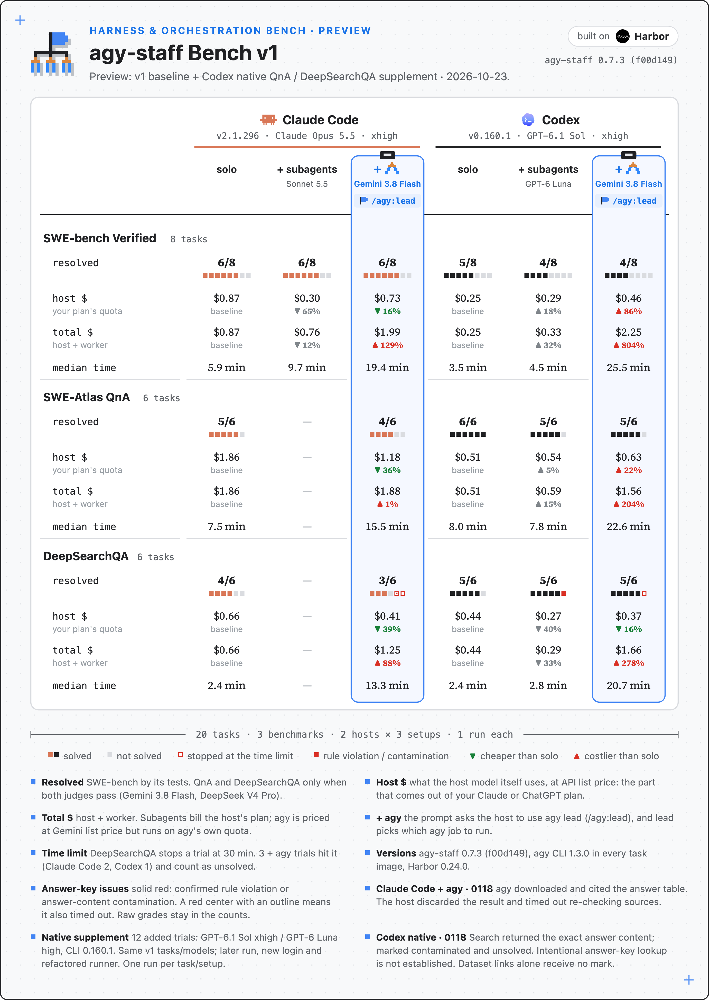

# v1 + Codex native supplement — preview

This preview fills the two missing Codex native cells in the v1 summary. It combines the 96 unchanged published v1 trials with the 12 completed native trials from 2026-10-23. The published v1 `data.json` remains unchanged.

[](summary.svg)

| Added Codex native group | Solved | Host USD / trial | Total USD / trial | Median minutes |
|---|---:|---:|---:|---:|
| SWE-Atlas QnA | 5/6 | 0.5401 | 0.5900 | 7.85 |
| DeepSearchQA | 5/6 | 0.2656 | 0.2946 | 2.75 |

The host is GPT-6.1 Sol xhigh, the worker GPT-6 Luna high, and the CLI Codex 0.160.1. The task IDs and models match v1, but the supplement ran later, with a different login and the refactored runner. Each setup has one run per task; this preview is not a controlled rerun of the whole matrix. Claude Code native remains unmeasured on QnA and DeepSearchQA.

The task squares follow the existing design: solid red means a confirmed rule violation or actual answer-content contamination; hollow red means timeout; a red center inside the outline means both. Merely encountering a dataset link gets no mark. The raw scores and denominators stay as graded.

- Claude Code + agy DeepSearchQA 0118: the worker downloaded and cited the answer table. The host discarded it and timed out re-checking sources. This is the existing v1 confirmed rule violation.
- Codex native DeepSearchQA 0118: ordinary searches returned the exact answer content into the worker context. The trial is contaminated and unsolved; intentional answer-key lookup is not established. It remains in the 5/6 denominator.
- Codex solo DeepSearchQA 0118: the result showed a dataset link and the question only. It receives no red issue mark.

The added jobs are selected by the completed `manifest-s61x-native-supplement-20261023-r1-rerun4.json`: its first valid QnA trial comes from rerun1, and the other 11 come from rerun4. Superseded s6x jobs and failed infrastructure attempts are excluded. The input manifest, analysis and manual audit checksums are recorded in `data.json` under `supplement_sources`; each trial retains its exact job name. This file contains only the selected plotting and audit fields, without credentials or raw trajectories.

To redraw this preview from the checked-in data (Python dependencies: `bench/requirements.txt`):

```sh
python3 bench/scripts/viz-svg.py bench/results/preview-native/data.json --bench v1
bench/scripts/render-png.sh bench/results/preview-native/summary.svg
```
