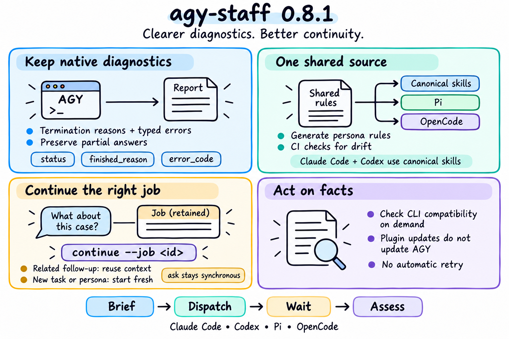

# agy-staff 0.8.1 — Clearer diagnostics. Better continuity.



## Changes since 0.8.0

Two quality improvements: [#48](https://github.com/keli-wen/agy-staff/issues/48) / [#49](https://github.com/keli-wen/agy-staff/pull/49) preserve AGY's native diagnostics, and [#51](https://github.com/keli-wen/agy-staff/issues/51) / [#52](https://github.com/keli-wen/agy-staff/pull/52) give every direct persona shared dispatch guidance and an explicit job-based continuation interface.

**Clearer diagnostics.** The companion retains native termination reasons and bounded typed error metadata alongside delivered responses, including partial answers. Hosts can distinguish normal completion, print timeout, interruption and API failure without inferring the cause from prose. Normal warning-free runs keep their low-noise output and intermediate-file cleanup. CLI version checks run only when an option or output format is rejected without a structured API error; plugin updates do not update the separate AGY binary. Errors never trigger an automatic retry or update.

**One source for persona rules.** `templates/persona-skill-rules.md` maintains four short host-facing rules: reuse helpful context for related follow-ups, start fresh when the task or role changes or an independent opinion is needed, pass new host-chat decisions without expanding authorization, and follow the existing execution and recovery boundaries. `npm run generate:skills` embeds them into all five canonical persona skills before generating Pi and OpenCode adapters. Claude Code and Codex load the canonical files directly. `npm run check:skills` and CI detect stale output or malformed shared blocks. Host dispatch guidance remains separate from worker prompts and guardrails.

**Continue the right job.** Natural follow-ups should reuse the matching completed job when its context helps, even if the user does not say “continue.” The host retains each job ID with its assignment and sends intervening decisions in the follow-up brief. This is guidance for the host agent, not an automatic topic-matching system. New topics, different personas, independent reviews and explicit fresh starts use new sessions.

The single continuation entry point is `continue --job <id>`. It retains the original persona and execution style, inherits the recorded model, permission profile and working directory unless a supported explicit override is supplied, and creates a linked invocation. Synchronous `ask` now records a job ID too: its answer remains on stdout, while stderr carries the job ID. Continuing an ask stays synchronous. Interleaved ask calls do not redirect default background result collection.

## Continuation migration

Use the job ID returned by the earlier invocation:

```bash
node "<plugin-root>/companion/agy-companion.mjs" continue --job <id> --prompt "Check the alternative discussed above"
```

- Persona `--continue`, `--conversation <id>`, persona `--job <id>`, and bare `continue` are rejected before invoking AGY. Errors provide a job-based migration command when a matching record exists.
- A conversation ID is not a job ID. Use `status` to inspect recorded jobs; a continued job keeps its original persona. To change roles, start the target persona with the relevant findings in its brief.
- Pre-0.8.1 ask conversations without a job record cannot be resumed through the new interface. Start a fresh ask to obtain a job ID; other existing jobs with recorded conversation IDs can be continued.
- A running job still must finish or be canceled before continuation. Execution-timeout recovery still requires explicit confirmation; a wait soft expiry only requires collecting the same job again.

## Validation

- The implementation passed 233 offline tests, including job-ID-only continuation, synchronous ask records, legacy-selector migration, shared-source generation and packaging.
- The subsequent rule simplification passed all 15 targeted generation and packaging tests. After correcting path-separator assertions, Ubuntu and Windows CI both passed, along with generated-skills consistency checks.
- Native AGY error-field serialization was checked during #49 against a localhost HTTP error stub. Live provider failure behavior, real host natural-follow-up selection and the opt-in live AGY continuation suite were not verified in these runs. No follow-up accuracy or performance improvement is claimed.

## Upgrading

Update the plugin and restart the host to load revised skills; see the [upgrade instructions](../REFERENCE.md#upgrading). Follow the continuation migration above when updating scripts. Package, Claude Code and Codex manifests are versioned at 0.8.1. Pi and OpenCode installations pinned to a Git ref can select `v0.8.1`.
