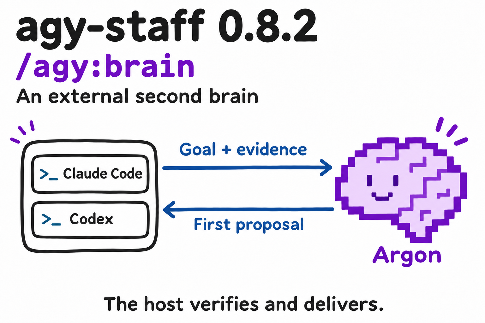

# agy-staff 0.8.2 — First proposal from an external brain

Use `agy:brain` when you want Argon to frame the problem before the host settles on an approach. The host supplies the goal, constraints and existing evidence, tests the proposal's assumptions, and owns execution and delivery. For example, if a migration proposal assumes every historical job has a conversation ID, check the old records and return any counterexample to the same brain conversation before implementing it.

The [brain skill](../../skills/brain/SKILL.md) starts a background `staffer --brain` job. It uses an advisory prompt and defaults to `gemini-4-argon-medium`; an explicit model selection is supported. A native Flash research child may gather read-only evidence. Regular workers keep their no-delegation rule. Follow-ups use `continue --job <id>` as in 0.8.1.

This first iteration makes no comparative cost or quality claim. For the mechanism probe and its limits, see [#50](https://github.com/keli-wen/agy-staff/issues/50).

## Live acceptance check

On November 6, 2026, a host ran the shipping `staffer --brain` path in a disposable repository using authenticated AGY 1.5.2, without a model override. The first brief requested a design for migrating job history and supplied only the one-to-one pattern seen in standalone runs. Argon Medium recommended keying reports by job ID, but proposed mapping historical link keys to a single report, and asked the host to check cardinality.

The host found four real, linked jobs with separate reports sharing one conversation ID; 15 completed jobs with no conversation ID; and a 0.8.0 foreground path that could record a conversation without a job. It sent those observations through `continue --job`. Argon retained the job ID as the report address, dropped the single-report conversation alias, separated jobless pointers from reports, and deferred URL rules pending an inventory. The host accepted the changed identity policy but treated the suggested leaf-job handle as a UI default, not a CLI requirement: the companion looks up the explicitly selected job and checks its conversation and running status.

Both job records show `brain: true`, `gemini-4-argon-medium`, and native success; the second has the first as parent and the same AGY conversation ID. This was one real two-turn design task, not a model comparison, a Flash delegation test, or a migration implementation.
