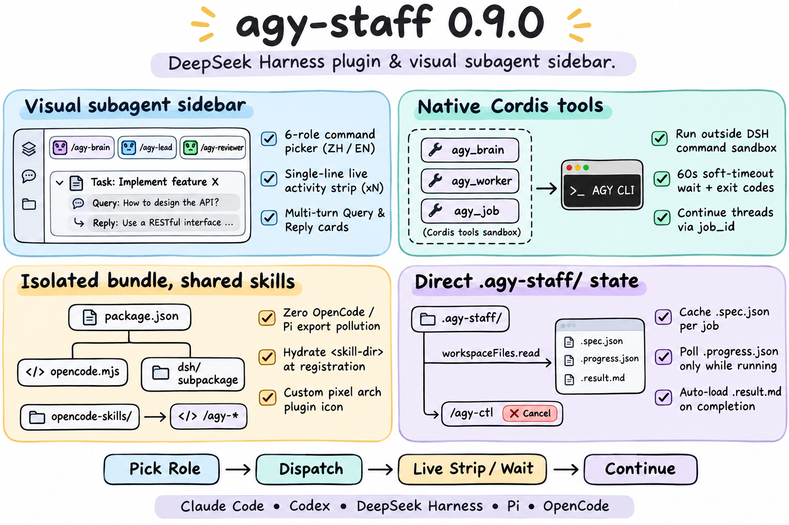

# agy-staff 0.9.0 — DeepSeek Harness plugin & visual subagent sidebar



## Highlights

`agy-staff` 0.9.0 adds native support for **DeepSeek Harness (`dsh`)** ([#54](https://github.com/keli-wen/agy-staff/issues/54) / [#55](https://github.com/keli-wen/agy-staff/pull/55)), pairing DeepSeek Harness sessions with Google's Antigravity CLI (`agy`) through three coordinated layers: a visual right-sidebar subagent companion, native Cordis lifecycle tools, and hydrated `/agy-*` skills.

### 1. Visual subagent right-sidebar (`dsh/client.js`)

- **Role capability picker**: Quick-insert cards for `/agy-brain` (Argon), `/agy-lead`, `/agy-staffer`, `/agy-researcher`, `/agy-reviewer`, and `/agy-implementer` (3.8 Flash) with `crispEdges` pixel-art SVG icons and a persistent `中 / EN` language toggle.
- **Multi-turn conversation cards**: Groups linked `continue --job <id>` runs into a single expandable thread card with per-turn `Query` and `Reply` viewports, distinct pixel status badges (`done`, `running`, `error`/`crashed`, `canceled`, `attention`), and one-click continuation / progress check insertion into the session input box.
- **Locked single-line live activity strip**: While a subagent is running, `.agy-live-strip` stays mounted at a fixed `20px` single-row height above `Query` / `Reply`, collapsing consecutive identical tool steps into `×N` counts (newest step first) so the cards below never shift on 5-second polls.
- **Automatic completion transition & low-overhead polling**: Expanding a running card never locks `turnDetails[id].loaded` early; when the turn transitions to a terminal state, the sidebar automatically loads `<id>.result.md`. Idle polling reads only `state.json` (1 read/5s), caching `.spec.json` per job ID and reading `.progress.json` exclusively for `running` / `queued` jobs.

### 2. Native Cordis lifecycle tools (`dsh/index.mjs`)

DeepSeek Harness's command sandbox blocks `agy` from binding its localhost language-server port and reading its OAuth keychain credentials. The server plugin registers three native Cordis tools that invoke `companion/agy-companion.mjs` outside the command sandbox with array arguments (`spawn(process.execPath, [...])`):

- **`agy_brain`**: Starts a `staffer --brain` job (defaulting to `gemini-4-argon-medium`) or continues an existing brain thread via `job_id`, returning `{ ok, job_id, status, output }`.
- **`agy_worker`**: Dispatches `research`, `review`, `implement`, `staffer`, or synchronous `ask` workers (or continues a thread via `job_id`). Passing `restricted: true` opts into `--restricted`; omitting or passing `false` defers to `.agy-staff/config.json`.
- **`agy_job`**: Full background job lifecycle tool supporting `wait` (60-second soft timeout with `timeoutMs: 75000`, treating exit code `0` as `done` and exit code `2` as `running` with `ok: true`), `observe`, `result`, `cancel`, and `status`.

### 3. Single-source `/agy-*` skills & isolated bundle packaging (`dsh/`, `package.json`)

- **Isolated `dsh/` subpackage**: Root `package.json` declares `dsh.bundle.patch` (`./dsh/cordis.patch.yml`) and exports `.` (`./opencode.mjs`), `./icon` (`./dsh/icon.svg`), and `./package.json`, keeping the OpenCode V1 and Pi entrypoints untouched while displaying the custom pixel rainbow arch icon in DeepSeek Harness's **Installed plugins** list.
- **Hydrated skills from `opencode-skills/`**: `dsh/index.mjs` registers all eight `agy-*` skills directly from `opencode-skills/`, replacing `<skill-dir>` and `<plugin-root>` at registration time and prepending a DeepSeek Harness note directing models to use `agy_brain`, `agy_worker`, and `agy_job`.

## Validation

- Passed `npm run check:skills` (Pi & OpenCode generated skills verified, 0 drift).
- Passed all **243 offline tests across 30 suites** (`npm test`), including `tests/dsh-plugin.test.mjs` (covering bundle manifest exports, skill hydration, `agy_brain` / `agy_worker` / `agy_job` exit-code semantics, `loadTurnData` running-to-done transition, `.agy-live-strip` deduplication and height locking, polling efficiency, and status icons), `tests/opencode-packaging.test.mjs`, and `tests/pi-packaging.test.mjs`.

## Installing & upgrading in DeepSeek Harness

Install in the **DeepSeek Harness** desktop app via **Plugins** (`github:keli-wen/agy-staff`), or from the terminal:

```bash
dsh plugin --profile desktop add github:keli-wen/agy-staff
```

See the [installation and upgrade guide](../REFERENCE.md#deepseek-harness) for local development and version-pinned upgrades.
