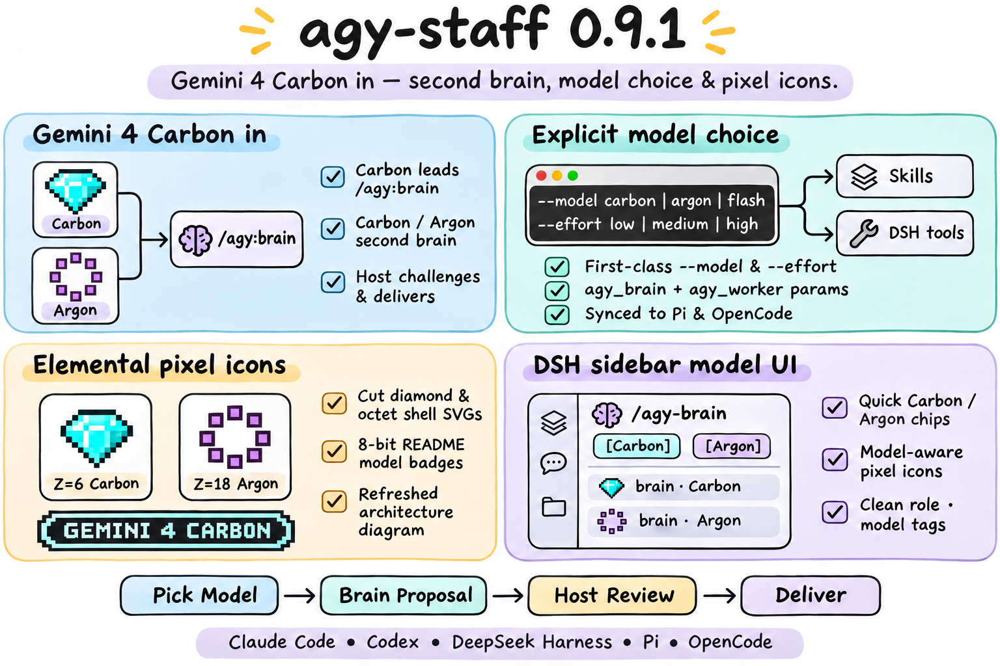

# agy-staff 0.9.1 — Gemini 4 Carbon in!

## Highlights

`agy-staff` 0.9.1 brings **Gemini 4 Carbon** (`gemini-4-carbon-{low,medium,high}`) into the companion model catalog and promotes it to the default external reasoning lead for `brain` ([#57](https://github.com/keli-wen/agy-staff/issues/57)), paired with **Gemini 4 Carbon / Argon** second-brain workflows, first-class `--model` and `--effort` selection across skills and DeepSeek Harness, quick `[Carbon]` / `[Argon]` model chips in the visual sidebar, and bespoke pixel-art icons and badges for Carbon and Argon.

### 1. Gemini 4 Carbon & expanded model catalog (`companion/agy-companion.mjs`)

- **Expanded model catalog & family aliases**: Added `gemini-4-carbon-{low,medium,high}`, `gemini-4-argon-{low,medium,high}`, `claude-opus-5-5-{low,medium,high}`, and `claude-sonnet-5-5-{low,medium,high}` to `KNOWN_MODELS` and `MODEL_FAMILIES`, plus short family aliases `carbon` (`gemini-4-carbon`) and `argon` (`gemini-4-argon`) alongside `flash` (`gemini-3.8-flash`) and `pro` (`gemini-3.1-pro`).
- **Gemini 4 Carbon / Argon second brain**: `staffer --brain` now defaults to `gemini-4-carbon-medium` while keeping `gemini-4-argon-*` a first-class peer option (`--model argon`). Continuation (`continue --job <id>`) preserves the conversation's resolved model unless explicitly overridden.
- **Strict explicit overrides**: Passing an explicit `--model` (such as `--model carbon` or `--model argon`) never switches models silently; if an explicitly requested model is unavailable, the companion surfaces the diagnostic and compatible recommendations directly.

### 2. First-class `--model` & `--effort` across skills & DeepSeek Harness (`skills/`, `dsh/index.mjs`)

- **Canonical & generated skills**: Updated `skills/brain/SKILL.md` (`argument-hint: '[--model carbon|argon|flash|<id>] [--effort low|medium|high] [task]'`) and persona skill references (`staffer`, `researcher`, `reviewer`, `implementer`, `ask`), regenerating `pi-skills/` and `opencode-skills/` with zero drift.
- **Cordis tool schema**: Added optional `model` and `effort` parameters to both `agy_brain` and `agy_worker` in `dsh/index.mjs`, forwarding `--model` and `--effort` on fresh launches and `continue --job` follow-ups.

### 3. Elemental pixel icons, README badges & DSH sidebar model UI (`assets/`, `dsh/client.js`)

- **Standalone SVG icons & pixel badges**: Added `assets/icons/carbon.svg` (cut diamond allotrope, $Z=6$) and `assets/icons/argon.svg` ($3s^2 3p^6$ octet shell, $Z=18$), generated `assets/badges/model-gemini-4-carbon.svg` and updated `assets/badges/model-gemini-4-argon.svg` via `scripts/gen_badges.py`, and refreshed `assets/design.svg` / `assets/design.png`.
- **DeepSeek Harness sidebar upgrades**: Added interactive `[Carbon]` and `[Argon]` quick-chips on `/agy-brain` in the capability picker (inserting `/agy-brain --model carbon ` or `/agy-brain --model argon ` directly into the input box), plus `PixelIconCarbon`, `PixelIconArgon`, and `shortModelTag` so brain and worker cards render model-accurate pixel icons and labels (`brain · Carbon`, `brain · Argon`, `staffer · Argon`, `researcher · Carbon`) and surface per-turn model tags in multi-turn threads when a turn's model differs from the thread lead.

## Validation

- Passed `npm run check:skills` (Pi & OpenCode generated skills verified, 0 drift) and `npm run pack:checked` (62 packaged files verified).
- Passed all offline tests across 30 suites (`npm test`), covering model catalog normalization, `brain` model resolution and continuity, explicit `--model` non-substitution invariants, sandbox/auth/entitlement diagnostic boundaries, and DeepSeek Harness `model`/`effort` forwarding, quick-chips, and `PixelIconCarbon`/`PixelIconArgon` rendering, plus `npm run test:pi` (`1/1` isolated Pi 0.84.4 package install).
