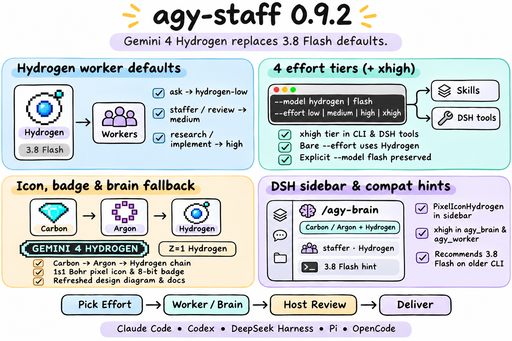

# agy-staff 0.9.2 — Gemini 4 Hydrogen in!

## Highlights

`agy-staff` **0.9.2** retires **Gemini 3.8 Flash** from all built-in defaults and promotes **Gemini 4 Hydrogen** (`gemini-4-hydrogen-{low,medium,high,xhigh}`) as the default worker model and `/agy:brain` fallback tail ([#59](https://github.com/keli-wen/agy-staff/issues/59)), while preserving `gemini-3.8-flash-*` and `--model flash` for explicit selection, job continuation, and older `agy` CLI diagnostics.

### 1. Gemini 4 Hydrogen defaults & `xhigh` effort (`companion/agy-companion.mjs`)

- **Worker defaults switched to Gemini 4 Hydrogen**:
  - `ask`: `gemini-4-hydrogen-low`
  - `staffer`: `gemini-4-hydrogen-medium`
  - `review`: `gemini-4-hydrogen-medium`
  - `research`: `gemini-4-hydrogen-high`
  - `implement`: `gemini-4-hydrogen-high`
- **Catalog, alias & 4-tier effort support**: Registered `gemini-4-hydrogen-{low,medium,high,xhigh}` in `KNOWN_MODELS` and `MODEL_FAMILIES`, added the `hydrogen` (`gemini-4-hydrogen`) family alias, enabled `--effort xhigh`, and pointed bare `--effort <tier>` shorthands to `gemini-4-hydrogen-<tier>`.
- **`brain` fallback chain (`Carbon -> Argon -> Hydrogen`)**: Updated `BRAIN_FALLBACK_CHAIN` to `gemini-4-carbon-medium` -> `gemini-4-argon-medium` -> `gemini-4-hydrogen-medium`.
- **Backward compatibility preserved**: Retained `gemini-3.8-flash-{low,medium,high}` and `--model flash` in the catalog; older `agy` catalogs without Hydrogen fail clearly without silent fallback and recommend same-effort `gemini-3.8-flash-<effort>` (or `agy update`).

### 2. Skills, templates & DeepSeek Harness (`skills/`, `templates/`, `dsh/`)

- **Canonical & generated skills**: Updated `skills/{ask,staffer,researcher,reviewer,implementer,brain}/SKILL.md` and `templates/brain.md` for Hydrogen defaults, `hydrogen` alias, and `xhigh` effort, regenerating `pi-skills/` and `opencode-skills/` with zero drift.
- **DeepSeek Harness (`dsh/index.mjs`, `dsh/client.js`, `dsh/package.json`)**: Added `hydrogen` alias guidance and `"xhigh"` to `effort` enums on `agy_brain` and `agy_worker`, added `PixelIconHydrogen` ($Z=1$ single-electron orbital), updated `shortModelTag` to recognize and default workers to `Hydrogen`, and updated sidebar capability labels to `Carbon / Argon + Hydrogen`.

### 3. Elemental pixel icon, badge & architecture diagram (`assets/`, `scripts/gen_badges.py`)

- Added `assets/icons/hydrogen.svg` ($Z=1$, $1s^1$ Bohr orbital) and generated `assets/badges/model-gemini-4-hydrogen.svg` via `scripts/gen_badges.py`.
- Updated `README.md`, `README.zh-CN.md`, `docs/REFERENCE.md`, `docs/REFERENCE.zh-CN.md`, `docs/DESIGN.md`, `assets/design.svg` / `assets/design.png`, and bumped manifests (`package.json`, `dsh/package.json`, `.claude-plugin/plugin.json`, `.claude-plugin/marketplace.json`, `.codex-plugin/plugin.json`) to `0.9.2`.
